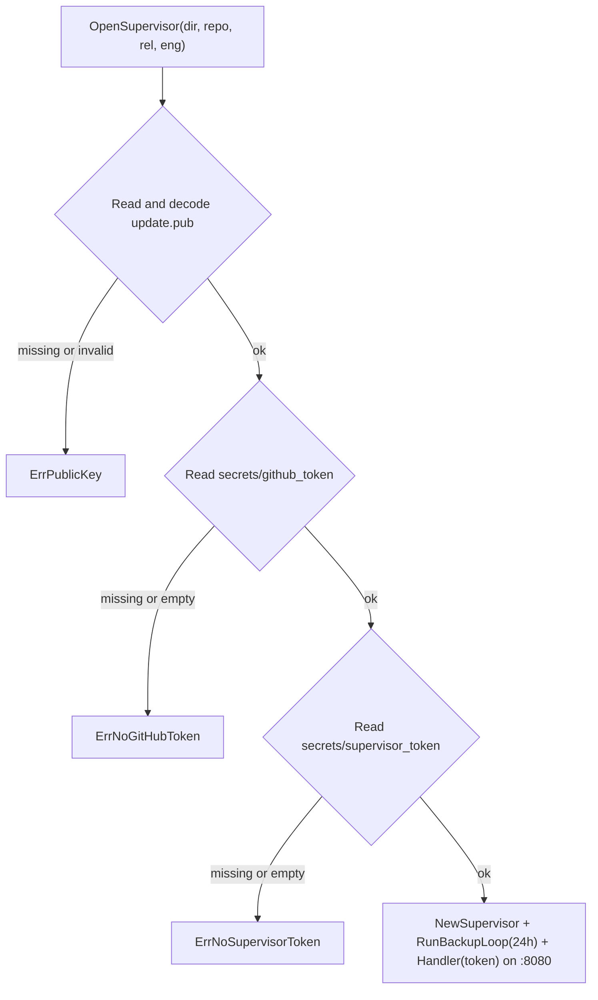

> Read AGENTS.md at the repo root before any change.
> **Finish by yourself:** when the delivery check passes, commit, push and open the pull request. Never ask whether to
> proceed or finalize — nobody answers, and a session that waits ends without your work.

# S4c-2b — `selfupdate install`, `selfupdate serve`, `Dockerfile` and release Action

## Context

`selfupdate` (v0.0.8) already verifies releases (`Checker`), applies updates with rollback (`Applier`), serves the HTTP
API (`Supervisor.Handler`), takes daily database dumps (`Supervisor.Backup`) and generates the canonical `compose.yaml`
(`ComposeFile`). This plan adds the executable entrypoint and its two commands:

1. `selfupdate install <owner/repo>`: downloads and verifies the latest signed Release (`manifest.txt`, `manifest.sig`,
   `compose.yaml`), extracts `<app>` and `<domain>` from the verified compose file, creates `/opt/<app>/{secrets,backups}`,
   generates the database passwords, `initdb.sql` and `supervisor_token`, sets the owner UID (`0`, `PostgresUID = 999`,
   `NonRootUID = 65532`) and mode (`0400`) on every secret file as required by `docs/ARCHITECTURE.md`, writes
   `update.pub`, `compose.yaml` and `.env`, pulls the image, starts `db`, runs `migrate`, brings the stack up, waits for
   `/health`, and records `state.json`.
2. `selfupdate serve <owner/repo> <app>`: loads `update.pub`, `secrets/github_token` and `secrets/supervisor_token` from
   `/opt/<app>`, starts the 24-hour `Supervisor.Backup()` loop, and serves `Supervisor.Handler(token)` on `:8080`.
3. `Dockerfile` and `.github/workflows/release.yml`: builds and publishes `ghcr.io/webtyp/selfupdate:<tag>` on every
   tag push.

Delivery rules: commit after every stage. Never run `git reset`, `git restore`, `git checkout -- <file>` or `git stash`
on your own work. Stuck for 30 minutes: open the PR anyway, listing what fails. A PR that does not compile, or whose
tests could not run, is a failed delivery.

## Tools

```bash
go install webtyp.com/devflow/cmd/gotest@latest
```

Environment: `GOPRIVATE=webtyp.com/*`, `GOFLAGS=-mod=mod`. No test may touch the network, Docker or `/opt`.

## Ecosystem search

- Signature verification and manifest parsing: `Checker.Check` (`check.go`) and `update.VerifyManifest` — **reuse**.
- Health wait and atomic file writes: `Applier` (`apply.go`) and `Compose` (`compose.go`) — **reuse**.
- Server layout constants (`DirRoot`, `DirSecrets`, `FilePublicKey`, `PostgresUID`, `NonRootUID`, etc.): `layout.go` —
  **reuse**.

## Design gate

1. **Prior art.** Kamal `kamal setup` bootstraps the server on first deploy and starts the containers
   (https://kamal-deploy.org/docs/commands/setup/); K3s installs with a single command that writes credentials with
   restricted permissions and starts the service (https://docs.k3s.io/quick-start); Docker Compose mounts file secrets
   preserving host UID and mode (https://docs.docker.com/compose/how-tos/use-secrets/). Same here: one `install`
   command sets up `/opt/<app>` with exact secret ownership and starts Compose; `serve` runs inside the supervisor
   container.
2. **Novice names.** `DecodePublicKey`, `InitDBSQL`, `ParseComposeApp`, `InstallConfig`, `Install`, `BackupInterval`,
   `OpenSupervisor`, `RunBackupLoop`, CLI `selfupdate install <owner/repo>` and `selfupdate serve <owner/repo> <app>`.
3. **Complexity ledger.** Concepts +2 (`Install`, `OpenSupervisor`) · ways to bootstrap a server: 1 (`selfupdate install`)
   · ways to run the supervisor daemon: 1 (`selfupdate serve`).
4. **Where it belongs.** `webtyp/selfupdate`.
5. **Deletes.** Nothing.

## APIs used

| Symbol | Signature | File |
|---|---|---|
| `Checker.Check` | `func (c Checker) Check(s State) (u Update, ok bool, err error)` | `check.go` |
| `ComposeFile`, `App` | `func ComposeFile(app App) ([]byte, error)` | `composefile.go` |
| `Supervisor`, `NewSupervisor`, `(*Supervisor).Backup`, `(*Supervisor).Handler` | as in `supervisor.go` | `supervisor.go` |
| Layout constants | `DirRoot`, `FileCompose`, `FileEnv`, `FilePublicKey`, `FileState`, `FileInitDB`, `DirSecrets`, `DirBackups`, `ServiceDB`, `ServiceApp`, `SupervisorPort`, `EnvAppDomain`, `EnvAppImage`, `EnvSupervisorImage`, `EnvLANAddress`, `SecretGitHubToken`, `SecretSupervisorToken`, `SecretTunnelToken`, `SecretDNSToken`, `SecretDBOwner`, `SecretDBApp`, `SecretDatabaseURL`, `SecretDatabaseOwnerURL`, `NonRootUID`, `PostgresUID` | `layout.go` |

If a signature differs, stop and name the symbol in the PR; never adapt it by guessing.

## Stage 1 — diagrams `docs/diagrams/INSTALL_FLOW.md` and `docs/diagrams/SERVE_FLOW.md` (new)

Create `docs/diagrams/INSTALL_FLOW.md`:

````markdown
# Install flow

What `selfupdate.Install(cfg)` does on a server. Every branch is tested in `tests/install_test.go`.

```mermaid
flowchart TD
    A["Install(InstallConfig)"] --> V{"Repo, PublicKey, GitHubToken,<br/>TunnelToken, DNSToken valid?"}
    V -->|no| EV["ErrAppRepo / ErrPublicKey / ErrNoGitHubToken /<br/>ErrNoTunnelToken / ErrNoDNSToken"]
    V -->|yes| C["Checker.Check(State{})"]
    C -->|error or !ok| EC["error or ErrNoRelease"]
    C -->|verified Update{Manifest, Compose}| P["ParseComposeApp(Compose) → app, domain"]
    P -->|invalid| EP["ErrAppName / ErrAppDomain"]
    P -->|ok| S["Write /opt/<app>/secrets/* (mode 0400, chown 0 / 999 / 65532)<br/>Write update.pub, compose.yaml, .env"]
    S --> D["Engine.Pull(ref) → Up(db) → Engine.Migrate(ref) → Up(all)"]
    D --> H{"Engine.Healthy() within Wait?"}
    H -->|no| EH["ErrUnhealthy"]
    H -->|yes| W["Save state.json (Version, Image)"]
```
````

Create `docs/diagrams/SERVE_FLOW.md`:

````markdown
# Serve flow

What `selfupdate serve <owner/repo> <app>` runs inside the supervisor container. Tested in `tests/serve_test.go`.


````

Commit.

## Stage 2 — `install.go` and `serve.go` (new)

Create `install.go`:

```go
package selfupdate

import (
	"crypto/ecdsa"
	"crypto/elliptic"
	"crypto/rand"
	"crypto/x509"
	"encoding/base64"
	"encoding/hex"
	"errors"
	"fmt"
	"os"
	"os/exec"
	"path/filepath"
	"strings"
	"time"
)

var (
	// ErrPublicKey: update.pub is missing or is not a P-256 PKIX public key.
	ErrPublicKey = errors.New("selfupdate: update.pub is not a valid P-256 public key")
	// ErrNoGitHubToken: secrets/github_token is missing or empty.
	ErrNoGitHubToken = errors.New("selfupdate: github token is required")
	// ErrNoSupervisorToken: secrets/supervisor_token is missing or empty.
	ErrNoSupervisorToken = errors.New("selfupdate: supervisor token is required")
	// ErrNoTunnelToken: tunnel token is missing or empty.
	ErrNoTunnelToken = errors.New("selfupdate: tunnel token is required")
	// ErrNoDNSToken: DNS token is missing or empty.
	ErrNoDNSToken = errors.New("selfupdate: DNS token is required")
	// ErrNoRelease: the repository has no release to install.
	ErrNoRelease = errors.New("selfupdate: no release found to install")
)

const (
	// DefaultSupervisorImage is the image written to .env when InstallConfig.SupervisorImage is empty.
	DefaultSupervisorImage = "ghcr.io/webtyp/selfupdate:latest"
	// DefaultLANAddress is the host bind address written to .env when InstallConfig.LANAddress is empty.
	DefaultLANAddress = "127.0.0.1"

	secretFileMode = 0o400
	dirMode        = 0o700
	rootUID        = 0
	randomBytes    = 32
	composeNamePfx = "name:"
	composeDomPfx  = "APP_DOMAIN:"
)

// DecodePublicKey accepts a P-256 PKIX public key either as raw DER bytes or base64 text,
// validates it, and returns the raw DER bytes that update.VerifyManifest expects.
// Example: pub, err := selfupdate.DecodePublicKey(data)
func DecodePublicKey(data []byte) ([]byte, error) {
	if isValidP256PublicKey(data) {
		return data, nil
	}
	trimmed := strings.TrimSpace(string(data))
	if trimmed == "" {
		return nil, ErrPublicKey
	}
	raw, err := base64.StdEncoding.DecodeString(trimmed)
	if err != nil || !isValidP256PublicKey(raw) {
		return nil, ErrPublicKey
	}
	return raw, nil
}

func isValidP256PublicKey(der []byte) bool {
	pub, err := x509.ParsePKIXPublicKey(der)
	if err != nil {
		return false
	}
	ec, ok := pub.(*ecdsa.PublicKey)
	return ok && ec.Curve == elliptic.P256()
}

// ParseComposeApp reads the app Name and APP_DOMAIN from a compose.yaml generated by ComposeFile.
// Example: name, domain, err := selfupdate.ParseComposeApp(composeBytes)
func ParseComposeApp(compose []byte) (name, domain string, err error) {
	for _, line := range strings.Split(string(compose), lineEnd) {
		trimmed := strings.TrimSpace(line)
		if name == "" && strings.HasPrefix(line, composeNamePfx) {
			name = strings.TrimSpace(strings.TrimPrefix(line, composeNamePfx))
		}
		if domain == "" && strings.HasPrefix(trimmed, composeDomPfx) {
			domain = strings.TrimSpace(strings.TrimPrefix(trimmed, composeDomPfx))
		}
	}
	if !validName(name) {
		return "", "", ErrAppName
	}
	if !validDomain(domain) {
		return "", "", ErrAppDomain
	}
	return name, domain, nil
}

// InitDBSQL returns the SQL script for secrets/initdb.sql that creates the rows-only <db>_app role
// and grants it DML on tables and USAGE/SELECT on sequences created by <db>_owner.
// Example: sql := selfupdate.InitDBSQL("acme_shop", appPassword)
func InitDBSQL(db, appPassword string) string {
	appRole := db + "_app"
	ownerRole := db + "_owner"
	escaped := strings.ReplaceAll(appPassword, "'", "''")
	return fmt.Sprintf(`CREATE ROLE %s WITH LOGIN PASSWORD '%s';
GRANT CONNECT ON DATABASE %s TO %s;
GRANT USAGE ON SCHEMA public TO %s;
GRANT SELECT, INSERT, UPDATE, DELETE ON ALL TABLES IN SCHEMA public TO %s;
GRANT USAGE, SELECT ON ALL SEQUENCES IN SCHEMA public TO %s;
ALTER DEFAULT PRIVILEGES FOR ROLE %s IN SCHEMA public GRANT SELECT, INSERT, UPDATE, DELETE ON TABLES TO %s;
ALTER DEFAULT PRIVILEGES FOR ROLE %s IN SCHEMA public GRANT USAGE, SELECT ON SEQUENCES TO %s;
`, appRole, escaped, db, appRole, appRole, appRole, appRole, ownerRole, appRole, ownerRole, appRole)
}

// InstallConfig holds the inputs and injectable seams for first-time installation on a server.
type InstallConfig struct {
	Repo            string
	Root            string // "" = DirRoot ("/opt")
	SupervisorImage string // "" = DefaultSupervisorImage
	LANAddress      string // "" = DefaultLANAddress
	PublicKey       string // base64 or raw P-256 public key
	GitHubToken     string
	TunnelToken     string
	DNSToken        string

	Releases Releases
	Engine   func(dir string) Engine
	Up       func(dir string, services ...string) error
	Chown    func(path string, uid, gid int) error
	Wait     time.Duration
	Every    time.Duration
	Now      func() time.Time
	Sleep    func(time.Duration)
}

// Install provisions /opt/<app>, writes secret files with their container UIDs and 0400 mode,
// starts db, runs migrate, brings the stack up, waits for health, and writes state.json.
// Example: state, err := selfupdate.Install(cfg)
func Install(cfg InstallConfig) (State, error) {
	if !validRepo(cfg.Repo) {
		return State{}, ErrAppRepo
	}
	pub, err := DecodePublicKey([]byte(cfg.PublicKey))
	if err != nil {
		return State{}, err
	}
	ghToken := strings.TrimSpace(cfg.GitHubToken)
	if ghToken == "" {
		return State{}, ErrNoGitHubToken
	}
	tunnelToken := strings.TrimSpace(cfg.TunnelToken)
	if tunnelToken == "" {
		return State{}, ErrNoTunnelToken
	}
	dnsToken := strings.TrimSpace(cfg.DNSToken)
	if dnsToken == "" {
		return State{}, ErrNoDNSToken
	}

	rel := cfg.Releases
	if rel == nil {
		rel = GitHub{Repo: cfg.Repo, Token: ghToken}
	}
	u, ok, err := (Checker{Releases: rel, PublicKey: pub}).Check(State{})
	if err != nil {
		return State{}, err
	}
	if !ok {
		return State{}, ErrNoRelease
	}
	appName, domain, err := ParseComposeApp(u.Compose)
	if err != nil {
		return State{}, err
	}

	root := cfg.Root
	if root == "" {
		root = DirRoot
	}
	dir := filepath.Join(root, appName)
	secretsDir := filepath.Join(dir, DirSecrets)
	backupsDir := filepath.Join(dir, DirBackups)
	for _, d := range []string{dir, secretsDir, backupsDir} {
		if err := os.MkdirAll(d, dirMode); err != nil {
			return State{}, err
		}
	}

	ownerPass, err := existingOrRandomSecret(filepath.Join(secretsDir, SecretDBOwner))
	if err != nil {
		return State{}, err
	}
	appPass, err := existingOrRandomSecret(filepath.Join(secretsDir, SecretDBApp))
	if err != nil {
		return State{}, err
	}
	supToken, err := existingOrRandomSecret(filepath.Join(secretsDir, SecretSupervisorToken))
	if err != nil {
		return State{}, err
	}

	db := databaseName(appName)
	dbURL := fmt.Sprintf("postgres://%s_app:%s@%s:5432/%s?sslmode=disable", db, appPass, ServiceDB, db)
	dbOwnerURL := fmt.Sprintf("postgres://%s_owner:%s@%s:5432/%s?sslmode=disable", db, ownerPass, ServiceDB, db)

	chown := cfg.Chown
	if chown == nil {
		chown = os.Chown
	}
	secrets := []struct {
		name string
		data string
		uid  int
	}{
		{SecretDBOwner, ownerPass, rootUID},
		{SecretDBApp, appPass, rootUID},
		{FileInitDB, InitDBSQL(db, appPass), PostgresUID},
		{SecretDatabaseURL, dbURL, NonRootUID},
		{SecretDatabaseOwnerURL, dbOwnerURL, NonRootUID},
		{SecretDNSToken, dnsToken, NonRootUID},
		{SecretSupervisorToken, supToken, NonRootUID},
		{SecretTunnelToken, tunnelToken, NonRootUID},
		{SecretGitHubToken, ghToken, rootUID},
	}
	for _, s := range secrets {
		p := filepath.Join(secretsDir, s.name)
		if err := writeSecret(p, []byte(s.data), s.uid, chown); err != nil {
			return State{}, err
		}
	}

	if err := writeAtomic(filepath.Join(dir, FilePublicKey), pub); err != nil {
		return State{}, err
	}
	if err := writeAtomic(filepath.Join(dir, FileCompose), u.Compose); err != nil {
		return State{}, err
	}

	supImage := cfg.SupervisorImage
	if supImage == "" {
		supImage = DefaultSupervisorImage
	}
	lanAddr := cfg.LANAddress
	if lanAddr == "" {
		lanAddr = DefaultLANAddress
	}
	ref := u.Manifest.Reference()
	envData := strings.Join([]string{
		EnvAppImage + envSeparator + ref,
		EnvAppDomain + envSeparator + domain,
		EnvSupervisorImage + envSeparator + supImage,
		EnvLANAddress + envSeparator + lanAddr,
	}, lineEnd) + lineEnd
	if err := writeAtomic(filepath.Join(dir, FileEnv), []byte(envData)); err != nil {
		return State{}, err
	}

	var eng Engine = Compose{Dir: dir}
	if cfg.Engine != nil {
		eng = cfg.Engine(dir)
	}
	up := cfg.Up
	if up == nil {
		up = defaultUp
	}

	if err := eng.Pull(ref); err != nil {
		return State{}, err
	}
	if err := up(dir, ServiceDB); err != nil {
		return State{}, err
	}
	if err := eng.Migrate(ref); err != nil {
		return State{}, fmt.Errorf("%w: %v", ErrMigrate, err)
	}
	if err := up(dir); err != nil {
		return State{}, err
	}
	applier := Applier{
		Engine: eng,
		Dir:    dir,
		Wait:   cfg.Wait,
		Every:  cfg.Every,
		Now:    cfg.Now,
		Sleep:  cfg.Sleep,
	}
	if !applier.waitHealthy() {
		return State{}, ErrUnhealthy
	}
	st := State{Version: u.Manifest.Version, Image: ref}
	if err := st.Save(filepath.Join(dir, FileState)); err != nil {
		return State{}, err
	}
	return st, nil
}

func existingOrRandomSecret(path string) (string, error) {
	if b, err := os.ReadFile(path); err == nil {
		if s := strings.TrimSpace(string(b)); s != "" {
			return s, nil
		}
	}
	buf := make([]byte, randomBytes)
	if _, err := rand.Read(buf); err != nil {
		return "", err
	}
	return hex.EncodeToString(buf), nil
}

func writeSecret(path string, data []byte, uid int, chown func(string, int, int) error) error {
	tmp := path + tmpSuffix
	if err := os.WriteFile(tmp, data, secretFileMode); err != nil {
		return err
	}
	if err := os.Chmod(tmp, secretFileMode); err != nil {
		os.Remove(tmp)
		return err
	}
	if err := chown(tmp, uid, uid); err != nil {
		os.Remove(tmp)
		return err
	}
	return os.Rename(tmp, path)
}

func defaultUp(dir string, services ...string) error {
	args := append([]string{argCompose, argUp, argDetach}, services...)
	cmd := exec.Command(cmdDocker, args...)
	cmd.Dir = dir
	out, err := cmd.CombinedOutput()
	if err != nil {
		return fmt.Errorf("%s %s: %w: %s", cmdDocker, strings.Join(args, " "), err, strings.TrimSpace(string(out)))
	}
	return nil
}
```

Create `serve.go`:

```go
package selfupdate

import (
	"context"
	"os"
	"path/filepath"
	"strings"
	"time"
)

// BackupInterval is the time between daily database copies in serve mode.
const BackupInterval = 24 * time.Hour

// OpenSupervisor loads update.pub, secrets/github_token and secrets/supervisor_token from dir
// and returns the configured Supervisor and its bearer token.
// Example: sup, token, err := selfupdate.OpenSupervisor(selfupdate.AppDir("shop"), "acme/shop", nil, nil)
func OpenSupervisor(dir, repo string, rel Releases, eng Engine) (*Supervisor, string, error) {
	if !validRepo(repo) {
		return nil, "", ErrAppRepo
	}
	pubRaw, err := os.ReadFile(filepath.Join(dir, FilePublicKey))
	if err != nil {
		return nil, "", ErrPublicKey
	}
	pub, err := DecodePublicKey(pubRaw)
	if err != nil {
		return nil, "", err
	}
	ghBytes, err := os.ReadFile(filepath.Join(dir, DirSecrets, SecretGitHubToken))
	if err != nil || strings.TrimSpace(string(ghBytes)) == "" {
		return nil, "", ErrNoGitHubToken
	}
	supBytes, err := os.ReadFile(filepath.Join(dir, DirSecrets, SecretSupervisorToken))
	if err != nil || strings.TrimSpace(string(supBytes)) == "" {
		return nil, "", ErrNoSupervisorToken
	}
	ghToken := strings.TrimSpace(string(ghBytes))
	supToken := strings.TrimSpace(string(supBytes))

	if rel == nil {
		rel = GitHub{Repo: repo, Token: ghToken}
	}
	if eng == nil {
		eng = Compose{Dir: dir}
	}
	checker := Checker{Releases: rel, PublicKey: pub}
	applier := Applier{Engine: eng, Dir: dir}
	return NewSupervisor(checker, applier, filepath.Join(dir, FileState)), supToken, nil
}

// RunBackupLoop calls s.Backup() on every tick of every (BackupInterval when <= 0) until ctx is done.
// Example: go selfupdate.RunBackupLoop(ctx, sup, selfupdate.BackupInterval)
func RunBackupLoop(ctx context.Context, s *Supervisor, every time.Duration) {
	if every <= 0 {
		every = BackupInterval
	}
	ticker := time.NewTicker(every)
	defer ticker.Stop()
	for {
		select {
		case <-ctx.Done():
			return
		case <-ticker.C:
			s.Backup()
		}
	}
}
```

Commit.

## Stage 3 — tests `tests/install_test.go` and `tests/serve_test.go` (new)

Create `tests/install_test.go`:

```go
package tests

import (
	"encoding/base64"
	"errors"
	"os"
	"path/filepath"
	"strings"
	"testing"
	"time"

	"webtyp.com/crypto/asym"
	"webtyp.com/selfupdate"
	"webtyp.com/update"
)

func buildInstallRelease(t *testing.T, pub, priv []byte) fakeReleases {
	t.Helper()
	compose, err := selfupdate.ComposeFile(selfupdate.App{
		Name:   "acme-shop",
		Domain: "app.example.com",
		Repo:   "acme/shop",
	})
	if err != nil {
		t.Fatal(err)
	}
	m := update.Manifest{
		Version:       "v1.0.0",
		Image:         testImage,
		Digest:        testDigest,
		ComposeDigest: update.Digest(compose),
	}
	text, sig, err := update.SignManifest(m, priv)
	if err != nil {
		t.Fatal(err)
	}
	return fakeReleases{
		tag: "v1.0.0",
		assets: map[string][]byte{
			update.ManifestAsset:  text,
			update.SignatureAsset: sig,
			update.ComposeAsset:   compose,
		},
	}
}

func TestDecodePublicKey_RawAndBase64(t *testing.T) {
	pub, _, err := asym.GenerateKeyPair()
	if err != nil {
		t.Fatal(err)
	}
	gotRaw, err := selfupdate.DecodePublicKey(pub)
	if err != nil || string(gotRaw) != string(pub) {
		t.Fatalf("DecodePublicKey(raw) err = %v", err)
	}
	b64 := base64.StdEncoding.EncodeToString(pub) + "\n"
	gotB64, err := selfupdate.DecodePublicKey([]byte(b64))
	if err != nil || string(gotB64) != string(pub) {
		t.Fatalf("DecodePublicKey(b64) err = %v", err)
	}
	if _, err := selfupdate.DecodePublicKey([]byte("not-a-key")); !errors.Is(err, selfupdate.ErrPublicKey) {
		t.Fatalf("expected ErrPublicKey, got %v", err)
	}
}

func TestInstall_ValidationErrors(t *testing.T) {
	pub, _, _ := asym.GenerateKeyPair()
	b64 := base64.StdEncoding.EncodeToString(pub)

	cases := []struct {
		cfg  selfupdate.InstallConfig
		want error
	}{
		{selfupdate.InstallConfig{Repo: "bad"}, selfupdate.ErrAppRepo},
		{selfupdate.InstallConfig{Repo: "acme/shop", PublicKey: "bad"}, selfupdate.ErrPublicKey},
		{selfupdate.InstallConfig{Repo: "acme/shop", PublicKey: b64}, selfupdate.ErrNoGitHubToken},
		{selfupdate.InstallConfig{Repo: "acme/shop", PublicKey: b64, GitHubToken: "gh"}, selfupdate.ErrNoTunnelToken},
		{selfupdate.InstallConfig{Repo: "acme/shop", PublicKey: b64, GitHubToken: "gh", TunnelToken: "tun"}, selfupdate.ErrNoDNSToken},
	}
	for _, tc := range cases {
		_, err := selfupdate.Install(tc.cfg)
		if !errors.Is(err, tc.want) {
			t.Errorf("Install(%+v) = %v, want %v", tc.cfg, err, tc.want)
		}
	}
}

func TestInstall_ProvisionsAndStarts(t *testing.T) {
	pub, priv, err := asym.GenerateKeyPair()
	if err != nil {
		t.Fatal(err)
	}
	rel := buildInstallRelease(t, pub, priv)
	root := t.TempDir()
	eng := &fakeEngine{healthyAfter: 1}
	var upCalls [][]string
	uidByFile := make(map[string]int)

	cfg := selfupdate.InstallConfig{
		Repo:        "acme/shop",
		Root:        root,
		PublicKey:   base64.StdEncoding.EncodeToString(pub),
		GitHubToken: "gh-secret",
		TunnelToken: "tun-secret",
		DNSToken:    "dns-secret",
		Releases:    rel,
		Engine:      func(string) selfupdate.Engine { return eng },
		Up: func(_ string, services ...string) error {
			upCalls = append(upCalls, services)
			return nil
		},
		Chown: func(path string, uid, _ int) error {
			name := strings.TrimSuffix(filepath.Base(path), ".tmp")
			uidByFile[name] = uid
			return nil
		},
		Wait:  10 * time.Second,
		Every: time.Second,
		Sleep: func(time.Duration) {},
	}

	st, err := selfupdate.Install(cfg)
	if err != nil {
		t.Fatalf("Install failed: %v", err)
	}
	if st.Version != "v1.0.0" {
		t.Fatalf("Version = %q, want v1.0.0", st.Version)
	}
	if len(upCalls) != 2 || len(upCalls[0]) != 1 || upCalls[0][0] != selfupdate.ServiceDB || len(upCalls[1]) != 0 {
		t.Fatalf("unexpected Up calls: %+v", upCalls)
	}

	appDir := filepath.Join(root, "acme-shop")
	secretsDir := filepath.Join(appDir, selfupdate.DirSecrets)
	wantUID := map[string]int{
		selfupdate.SecretDBOwner:          0,
		selfupdate.SecretDBApp:            0,
		selfupdate.FileInitDB:             selfupdate.PostgresUID,
		selfupdate.SecretDatabaseURL:      selfupdate.NonRootUID,
		selfupdate.SecretDatabaseOwnerURL: selfupdate.NonRootUID,
		selfupdate.SecretDNSToken:         selfupdate.NonRootUID,
		selfupdate.SecretSupervisorToken:  selfupdate.NonRootUID,
		selfupdate.SecretTunnelToken:      selfupdate.NonRootUID,
		selfupdate.SecretGitHubToken:      0,
	}
	for name, want := range wantUID {
		info, err := os.Stat(filepath.Join(secretsDir, name))
		if err != nil {
			t.Fatalf("missing secret %s: %v", name, err)
		}
		if info.Mode().Perm() != 0o400 {
			t.Errorf("%s mode = %o, want 0400", name, info.Mode().Perm())
		}
		if uidByFile[name] != want {
			t.Errorf("%s uid = %d, want %d", name, uidByFile[name], want)
		}
	}

	sqlBytes, err := os.ReadFile(filepath.Join(secretsDir, selfupdate.FileInitDB))
	if err != nil {
		t.Fatal(err)
	}
	sql := string(sqlBytes)
	if !strings.Contains(sql, "CREATE ROLE acme_shop_app") || !strings.Contains(sql, "ALTER DEFAULT PRIVILEGES FOR ROLE acme_shop_owner") {
		t.Fatalf("unexpected initdb.sql: %s", sql)
	}

	envBytes, err := os.ReadFile(filepath.Join(appDir, selfupdate.FileEnv))
	if err != nil {
		t.Fatal(err)
	}
	envText := string(envBytes)
	for _, wantLine := range []string{
		"APP_IMAGE=" + testImage + "@" + testDigest,
		"APP_DOMAIN=app.example.com",
		"SUPERVISOR_IMAGE=" + selfupdate.DefaultSupervisorImage,
		"LAN_ADDRESS=127.0.0.1",
	} {
		if !strings.Contains(envText, wantLine) {
			t.Errorf(".env missing %q in:\n%s", wantLine, envText)
		}
	}

	owner1, _ := os.ReadFile(filepath.Join(secretsDir, selfupdate.SecretDBOwner))
	sup1, _ := os.ReadFile(filepath.Join(secretsDir, selfupdate.SecretSupervisorToken))
	if _, err := selfupdate.Install(cfg); err != nil {
		t.Fatalf("second Install failed: %v", err)
	}
	owner2, _ := os.ReadFile(filepath.Join(secretsDir, selfupdate.SecretDBOwner))
	sup2, _ := os.ReadFile(filepath.Join(secretsDir, selfupdate.SecretSupervisorToken))
	if string(owner1) != string(owner2) || string(sup1) != string(sup2) {
		t.Fatal("expected second Install to preserve generated database and supervisor secrets")
	}
}

func TestInstall_Unhealthy(t *testing.T) {
	pub, priv, _ := asym.GenerateKeyPair()
	rel := buildInstallRelease(t, pub, priv)
	root := t.TempDir()
	clk := &clock{}
	eng := &fakeEngine{healthyAfter: 999}

	cfg := selfupdate.InstallConfig{
		Repo:        "acme/shop",
		Root:        root,
		PublicKey:   base64.StdEncoding.EncodeToString(pub),
		GitHubToken: "gh",
		TunnelToken: "tun",
		DNSToken:    "dns",
		Releases:    rel,
		Engine:      func(string) selfupdate.Engine { return eng },
		Up:          func(string, ...string) error { return nil },
		Chown:       func(string, int, int) error { return nil },
		Wait:        6 * time.Second,
		Every:       3 * time.Second,
		Now:         clk.Now,
		Sleep:       clk.Sleep,
	}
	_, err := selfupdate.Install(cfg)
	if !errors.Is(err, selfupdate.ErrUnhealthy) {
		t.Fatalf("got %v, want ErrUnhealthy", err)
	}
	if _, err := os.Stat(filepath.Join(root, "acme-shop", selfupdate.FileState)); !errors.Is(err, os.ErrNotExist) {
		t.Fatalf("expected no state.json on unhealthy install, got %v", err)
	}
}
```

Create `tests/serve_test.go`:

```go
package tests

import (
	"context"
	"encoding/base64"
	"errors"
	"net/http"
	"net/http/httptest"
	"os"
	"path/filepath"
	"strings"
	"testing"
	"time"

	"webtyp.com/crypto/asym"
	"webtyp.com/selfupdate"
)

func TestOpenSupervisor_MissingFiles(t *testing.T) {
	dir := t.TempDir()
	if _, _, err := selfupdate.OpenSupervisor(dir, "bad", nil, nil); !errors.Is(err, selfupdate.ErrAppRepo) {
		t.Fatalf("got %v, want ErrAppRepo", err)
	}
	if _, _, err := selfupdate.OpenSupervisor(dir, "acme/shop", nil, nil); !errors.Is(err, selfupdate.ErrPublicKey) {
		t.Fatalf("got %v, want ErrPublicKey", err)
	}
	pub, _, _ := asym.GenerateKeyPair()
	os.WriteFile(filepath.Join(dir, selfupdate.FilePublicKey), pub, 0o600)
	if _, _, err := selfupdate.OpenSupervisor(dir, "acme/shop", nil, nil); !errors.Is(err, selfupdate.ErrNoGitHubToken) {
		t.Fatalf("got %v, want ErrNoGitHubToken", err)
	}
	secretsDir := filepath.Join(dir, selfupdate.DirSecrets)
	os.MkdirAll(secretsDir, 0o700)
	os.WriteFile(filepath.Join(secretsDir, selfupdate.SecretGitHubToken), []byte("gh"), 0o600)
	if _, _, err := selfupdate.OpenSupervisor(dir, "acme/shop", nil, nil); !errors.Is(err, selfupdate.ErrNoSupervisorToken) {
		t.Fatalf("got %v, want ErrNoSupervisorToken", err)
	}
}

func TestOpenSupervisor_AndBackupLoop(t *testing.T) {
	pub, priv, _ := asym.GenerateKeyPair()
	rel := buildInstallRelease(t, pub, priv)
	root := t.TempDir()
	eng := &fakeEngine{healthyAfter: 1}

	cfg := selfupdate.InstallConfig{
		Repo:        "acme/shop",
		Root:        root,
		PublicKey:   base64.StdEncoding.EncodeToString(pub),
		GitHubToken: "gh-secret",
		TunnelToken: "tun-secret",
		DNSToken:    "dns-secret",
		Releases:    rel,
		Engine:      func(string) selfupdate.Engine { return eng },
		Up:          func(string, ...string) error { return nil },
		Chown:       func(string, int, int) error { return nil },
		Wait:        5 * time.Second,
		Every:       time.Second,
		Sleep:       func(time.Duration) {},
	}
	if _, err := selfupdate.Install(cfg); err != nil {
		t.Fatal(err)
	}

	appDir := filepath.Join(root, "acme-shop")
	sup, token, err := selfupdate.OpenSupervisor(appDir, "acme/shop", rel, eng)
	if err != nil {
		t.Fatal(err)
	}

	ctx, cancel := context.WithCancel(context.Background())
	defer cancel()
	go selfupdate.RunBackupLoop(ctx, sup, 5*time.Millisecond)

	backupsDir := filepath.Join(appDir, selfupdate.DirBackups)
	deadline := time.Now().Add(2 * time.Second)
	found := false
	for time.Now().Before(deadline) {
		entries, _ := os.ReadDir(backupsDir)
		for _, e := range entries {
			if strings.HasSuffix(e.Name(), ".sql") {
				found = true
				break
			}
		}
		if found {
			break
		}
		time.Sleep(5 * time.Millisecond)
	}
	cancel()
	if !found {
		t.Fatal("expected RunBackupLoop to write a .sql dump into backups/")
	}

	req := httptest.NewRequest(http.MethodGet, selfupdate.PathStatus, nil)
	req.Header.Set("Authorization", "Bearer "+token)
	rec := httptest.NewRecorder()
	sup.Handler(token).ServeHTTP(rec, req)
	if rec.Code != http.StatusOK || !strings.Contains(rec.Body.String(), "v1.0.0") {
		t.Fatalf("status = %d, body = %s", rec.Code, rec.Body.String())
	}
}
```

Run `gotest`: green. Commit.

## Stage 4 — CLI `cmd/selfupdate/main.go`, `Dockerfile` and `.github/workflows/release.yml` (new)

Create `cmd/selfupdate/main.go`:

```go
package main

import (
	"bufio"
	"context"
	"fmt"
	"net/http"
	"os"
	"strings"

	"webtyp.com/selfupdate"
)

func main() {
	if len(os.Args) < 2 {
		usage()
		os.Exit(1)
	}
	switch os.Args[1] {
	case "serve":
		if len(os.Args) != 4 {
			usage()
			os.Exit(1)
		}
		repo, app := os.Args[2], os.Args[3]
		sup, token, err := selfupdate.OpenSupervisor(selfupdate.AppDir(app), repo, nil, nil)
		if err != nil {
			fmt.Fprintln(os.Stderr, err)
			os.Exit(1)
		}
		go selfupdate.RunBackupLoop(context.Background(), sup, selfupdate.BackupInterval)
		if err := http.ListenAndServe(":"+selfupdate.SupervisorPort, sup.Handler(token)); err != nil {
			fmt.Fprintln(os.Stderr, err)
			os.Exit(1)
		}
	case "install":
		if len(os.Args) != 3 {
			usage()
			os.Exit(1)
		}
		in := bufio.NewReader(os.Stdin)
		cfg := selfupdate.InstallConfig{
			Repo:            os.Args[2],
			PublicKey:       envOrPrompt(in, "PUBLIC_KEY", "Publisher public key (update.pub, base64): "),
			GitHubToken:     envOrPrompt(in, "GITHUB_TOKEN", "GitHub read token: "),
			TunnelToken:     envOrPrompt(in, "TUNNEL_TOKEN", "Cloudflare Tunnel token: "),
			DNSToken:        envOrPrompt(in, "DNS_TOKEN", "Cloudflare DNS API token: "),
			LANAddress:      os.Getenv(selfupdate.EnvLANAddress),
			SupervisorImage: os.Getenv(selfupdate.EnvSupervisorImage),
		}
		st, err := selfupdate.Install(cfg)
		if err != nil {
			fmt.Fprintln(os.Stderr, err)
			os.Exit(1)
		}
		fmt.Println(st.Version)
	default:
		usage()
		os.Exit(1)
	}
}

func envOrPrompt(in *bufio.Reader, key, prompt string) string {
	if v := strings.TrimSpace(os.Getenv(key)); v != "" {
		return v
	}
	fmt.Fprint(os.Stderr, prompt)
	line, _ := in.ReadString('\n')
	return strings.TrimSpace(line)
}

func usage() {
	fmt.Fprintln(os.Stderr, "Usage:\n  selfupdate install <owner/repo>\n  selfupdate serve <owner/repo> <app>")
}
```

Create `Dockerfile`:

```dockerfile
FROM golang:1.26-alpine AS build
WORKDIR /src
COPY . .
RUN CGO_ENABLED=0 go build -trimpath -ldflags="-s -w" -o /out/selfupdate ./cmd/selfupdate

FROM alpine:3.21
RUN apk add --no-cache ca-certificates docker-cli docker-cli-compose
COPY --from=build /out/selfupdate /usr/local/bin/selfupdate
ENTRYPOINT ["/usr/local/bin/selfupdate"]
```

Create `.github/workflows/release.yml`:

```yaml
name: release
on:
  push:
    tags:
      - "v*"
permissions:
  contents: read
  packages: write
jobs:
  image:
    runs-on: ubuntu-latest
    steps:
      - uses: actions/checkout@v4
      - name: Log in to ghcr.io
        run: echo "${{ secrets.GITHUB_TOKEN }}" | docker login ghcr.io -u "${{ github.actor }}" --password-stdin
      - name: Build and push image
        run: |
          TAG="${GITHUB_REF_NAME}"
          docker build --platform linux/amd64 \
            -t "ghcr.io/webtyp/selfupdate:${TAG}" \
            -t "ghcr.io/webtyp/selfupdate:latest" .
          docker push "ghcr.io/webtyp/selfupdate:${TAG}"
          docker push "ghcr.io/webtyp/selfupdate:latest"
```

Run `gotest`: green. Commit.

## Stage 5 — docs

Update `README.md` and `docs/ARCHITECTURE.md`:
- Document `selfupdate install <owner/repo>` and `selfupdate serve <owner/repo> <app>`.
- Link `docs/diagrams/INSTALL_FLOW.md` and `docs/diagrams/SERVE_FLOW.md`.

Commit.

## Delivery check

1. `gotest` passes (including `-race`).
2. `git diff --stat main` lists only `install.go`, `serve.go`, `cmd/selfupdate/main.go`, `Dockerfile`,
   `.github/workflows/release.yml`, `tests/install_test.go`, `tests/serve_test.go`, `docs/diagrams/INSTALL_FLOW.md`,
   `docs/diagrams/SERVE_FLOW.md`, `docs/ARCHITECTURE.md`, `README.md`.
3. `git diff --stat main --diff-filter=D` → empty.

## Stages

| # | Files | Result |
|---|---|---|
| 1 | `docs/diagrams/INSTALL_FLOW.md`, `docs/diagrams/SERVE_FLOW.md` | Install and serve flow diagrams |
| 2 | `install.go`, `serve.go` | `DecodePublicKey`, `InitDBSQL`, `ParseComposeApp`, `Install`, `OpenSupervisor`, `RunBackupLoop` |
| 3 | `tests/install_test.go`, `tests/serve_test.go` | Full test suite for install and serve |
| 4 | `cmd/selfupdate/main.go`, `Dockerfile`, `.github/workflows/release.yml` | CLI, container image and GitHub Action |
| 5 | `README.md`, `docs/ARCHITECTURE.md` | Documented |
