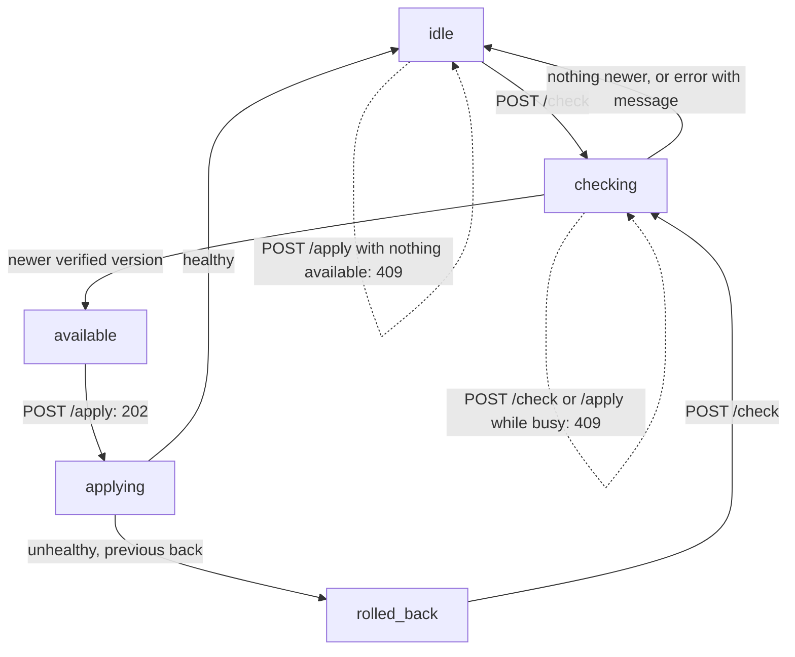

> Read AGENTS.md at the repo root before any change. Design: `docs/ARCHITECTURE.md` («Talking to the supervisor»).
> **Finish by yourself:** when the delivery check passes, commit, push and open the pull request. Never ask whether to
> proceed or finalize — nobody answers, and a session that waits ends without your work.

# HTTP API

## Context

v0.0.3 has `Checker.Check` (find a newer verified version) and `Applier.Apply` (switch to it, roll back if unhealthy).
The app talks to the supervisor over the Compose internal network to decide **when** (nobody connected, or the admin
presses the button): `GET /status`, `POST /check`, `POST /apply`, each with `Authorization: Bearer <token>`. This plan
adds `Supervisor` (the state machine around Checker and Applier, one operation at a time) and its `http.Handler`. The
`serve`/`install` commands and the container image come in a later plan.

## Tools

```bash
go install webtyp.com/devflow/cmd/gotest@latest
```

Environment: `GOPRIVATE=webtyp.com/*,github.com/veltylabs/*`, `GOFLAGS=-mod=mod`.

## Design gate

1. **Prior art.** Home Assistant's supervisor exposes `/supervisor/info` and `/supervisor/update` to the UI with a token;
   Watchtower's HTTP API mode answers `/v1/update` behind a bearer token (unverified: pages not read in this session).
2. **Novice names.** `selfupdate.NewSupervisor(checker, applier, statePath)`, `(*Supervisor).Status()`, `.Check()`,
   `.Apply()`, `.Handler(token)`, phases `idle`, `checking`, `available`, `applying`, `rolled_back`.
3. **Complexity ledger.** Concepts +2 (Supervisor, Status) · one way to drive an update (these three requests).
4. **Where it belongs.** `selfupdate`.
5. **Deletes.** Nothing.

## APIs used

| Symbol | Exact signature | Where |
|---|---|---|
| `Checker`, `(Checker).Check` | `func (c Checker) Check(s State) (m update.Manifest, ok bool, err error)` | `check.go` |
| `Applier`, `(Applier).Apply` | `func (a Applier) Apply(s State, m update.Manifest) (State, error)`; `ErrUnhealthy` | `apply.go` |
| `LoadState` | `func LoadState(path string) (State, error)` | `state.go` |
| `crypto/subtle.ConstantTimeCompare` | stdlib | — |

If a signature differs, stop and name the symbol in the PR; never adapt it by guessing.

## Stage 1 — diagram `docs/diagrams/PHASES.md` (new)

````markdown
# Supervisor phases

What `GET /status` reports and how each request moves it. Every arrow has a test in `tests/supervisor_test.go`.


````

Commit after this stage.

## Stage 2 — tests first: `tests/supervisor_test.go` (new)

Reuse `fakeReleases` (`tests/check_test.go`) and `fakeEngine` (`tests/apply_test.go`); a signed manifest for `v1.2.0`
as in `TestCheck_Available`; `dir := t.TempDir()`; the running state saved first with
`State{Version: "v1.1.0", Image: "ghcr.io/acme/shop@sha256:<64 x '0'>"}.Save(dir + "/state.json")`; the Applier with
`Dir: dir, Wait: 10*time.Second, Every: time.Second` and a fake clock (`Now`/`Sleep`) as in `tests/apply_test.go`.
`s := selfupdate.NewSupervisor(checker, applier, dir+"/state.json")`.

| Test | Steps | Expected |
|---|---|---|
| `TestSupervisor_StartsIdle` | `s.Status()` | `Phase == "idle"`, `Version == "v1.1.0"`, `Available == ""` |
| `TestSupervisor_CheckFindsVersion` | `s.Check()` | returns `nil`; status `available`, `Available == "v1.2.0"` |
| `TestSupervisor_CheckNothingNewer` | fake tag `v1.1.0`; `s.Check()` | `nil`; `idle` |
| `TestSupervisor_CheckError` | fake `Latest` error; `s.Check()` | that error; status `idle`, `Message` is the error text |
| `TestSupervisor_ApplyHealthy` | `Check()`, then `s.Apply()` with a healthy engine | `nil`; status `idle`, `Version == "v1.2.0"`, `Available == ""` |
| `TestSupervisor_ApplyUnhealthy` | `Check()`, then `Apply()` with a never-healthy engine | `errors.Is(err, ErrUnhealthy)`; status `rolled_back`, `Version == "v1.1.0"`, `Message` set |
| `TestSupervisor_ApplyNothing` | `s.Apply()` without a check | `errors.Is(err, selfupdate.ErrNothingToApply)` |

`tests/handler_test.go` (new) — `srv := httptest.NewServer(s.Handler("secret"))`:

| Test | Request | Expected |
|---|---|---|
| `TestHandler_NoToken` | `GET /status` without header | 401 |
| `TestHandler_WrongToken` | `Authorization: Bearer nope` | 401 |
| `TestHandler_EmptyTokenDeniesAll` | `s.Handler("")`, request with `Bearer ` | 401 |
| `TestHandler_Status` | `GET /status` with `Bearer secret` | 200, JSON `{"version":"v1.1.0","phase":"idle"}` (decode into `selfupdate.Status`) |
| `TestHandler_Check` | `POST /check` | 200, status `available` |
| `TestHandler_CheckFails` | fake `Latest` error, `POST /check` | 502, JSON status with `message` |
| `TestHandler_ApplyAccepted` | `POST /check`, then `POST /apply` (healthy engine) | 202; polling `GET /status` (up to 50 × 10 ms) reaches `idle` with `version` `v1.2.0` |
| `TestHandler_ApplyNothing` | `POST /apply` first | 409 |
| `TestHandler_WrongMethod` | `GET /apply` | 405 |
| `TestHandler_UnknownPath` | `GET /nope` | 404 |

Commit after this stage (red).

## Stage 3 — `supervisor.go` (new)

```go
package selfupdate

import (
	"crypto/subtle"
	"encoding/json"
	"errors"
	"net/http"
	"strings"
	"sync"

	"webtyp.com/update"
)

// Phase is where the supervisor is (docs/diagrams/PHASES.md).
type Phase string

const (
	PhaseIdle       Phase = "idle"
	PhaseChecking   Phase = "checking"
	PhaseAvailable  Phase = "available"
	PhaseApplying   Phase = "applying"
	PhaseRolledBack Phase = "rolled_back"
)

var (
	// ErrBusy: a check or an apply is already running.
	ErrBusy = errors.New("selfupdate: a check or an update is already running")
	// ErrNothingToApply: no verified version is waiting; check first.
	ErrNothingToApply = errors.New("selfupdate: no version is waiting to be applied")
)

const (
	PathStatus = "/status"
	PathCheck  = "/check"
	PathApply  = "/apply"

	headerAuthorization = "Authorization"
	headerContentType   = "Content-Type"
	contentJSON         = "application/json"
)

// Status is what GET /status answers.
type Status struct {
	Version   string `json:"version"`
	Available string `json:"available,omitempty"`
	Phase     Phase  `json:"phase"`
	Message   string `json:"message,omitempty"`
}

// Supervisor runs one check or one apply at a time and remembers the version
// waiting to be applied.
// Example: s := selfupdate.NewSupervisor(checker, applier, dir+"/"+selfupdate.FileState)
type Supervisor struct {
	checker   Checker
	applier   Applier
	statePath string

	mu        sync.Mutex
	phase     Phase
	available *update.Manifest
	message   string
}

func NewSupervisor(c Checker, a Applier, statePath string) *Supervisor {
	return &Supervisor{checker: c, applier: a, statePath: statePath, phase: PhaseIdle}
}

// Status reports the running version (from the state file), the waiting one and the phase.
func (s *Supervisor) Status() Status {
	s.mu.Lock()
	defer s.mu.Unlock()
	st := Status{Phase: s.phase, Message: s.message}
	if state, err := LoadState(s.statePath); err == nil {
		st.Version = state.Version
	} else {
		st.Message = err.Error()
	}
	if s.available != nil {
		st.Available = s.available.Version
	}
	return st
}

// Check looks for a newer verified version.
func (s *Supervisor) Check() error {
	state, err := s.begin(PhaseChecking)
	if err != nil {
		return err
	}
	m, ok, err := s.checker.Check(state)
	s.mu.Lock()
	defer s.mu.Unlock()
	s.available = nil
	s.phase = PhaseIdle
	s.message = ""
	if err != nil {
		s.message = err.Error()
		return err
	}
	if ok {
		s.available = &m
		s.phase = PhaseAvailable
	}
	return nil
}

// Apply switches to the waiting version (blocking; the HTTP handler runs it in the background).
func (s *Supervisor) Apply() error {
	s.mu.Lock()
	if s.phase == PhaseChecking || s.phase == PhaseApplying {
		s.mu.Unlock()
		return ErrBusy
	}
	if s.available == nil {
		s.mu.Unlock()
		return ErrNothingToApply
	}
	m := *s.available
	s.phase = PhaseApplying
	s.message = ""
	s.mu.Unlock()

	state, err := LoadState(s.statePath)
	if err == nil {
		_, err = s.applier.Apply(state, m)
	}
	s.mu.Lock()
	defer s.mu.Unlock()
	s.available = nil
	s.phase = PhaseIdle
	if err != nil {
		s.message = err.Error()
		if errors.Is(err, ErrUnhealthy) {
			s.phase = PhaseRolledBack
		}
	}
	return err
}

// begin moves to a busy phase unless one is running, and reads the state.
func (s *Supervisor) begin(p Phase) (State, error) {
	s.mu.Lock()
	if s.phase == PhaseChecking || s.phase == PhaseApplying {
		s.mu.Unlock()
		return State{}, ErrBusy
	}
	s.phase = p
	s.mu.Unlock()
	state, err := LoadState(s.statePath)
	if err != nil {
		s.mu.Lock()
		s.phase = PhaseIdle
		s.message = err.Error()
		s.mu.Unlock()
	}
	return state, err
}

// Handler serves GET /status, POST /check and POST /apply to whoever presents
// the token. An empty token denies every request.
// Example: http.ListenAndServe(":"+selfupdate.SupervisorPort, s.Handler(token))
func (s *Supervisor) Handler(token string) http.Handler {
	return http.HandlerFunc(func(w http.ResponseWriter, r *http.Request) {
		if !authorized(r, token) {
			w.WriteHeader(http.StatusUnauthorized)
			return
		}
		switch r.URL.Path {
		case PathStatus:
			if r.Method != http.MethodGet {
				w.WriteHeader(http.StatusMethodNotAllowed)
				return
			}
			writeStatus(w, http.StatusOK, s.Status())
		case PathCheck:
			if r.Method != http.MethodPost {
				w.WriteHeader(http.StatusMethodNotAllowed)
				return
			}
			err := s.Check()
			switch {
			case errors.Is(err, ErrBusy):
				writeStatus(w, http.StatusConflict, s.Status())
			case err != nil:
				writeStatus(w, http.StatusBadGateway, s.Status())
			default:
				writeStatus(w, http.StatusOK, s.Status())
			}
		case PathApply:
			if r.Method != http.MethodPost {
				w.WriteHeader(http.StatusMethodNotAllowed)
				return
			}
			s.mu.Lock()
			ready := s.available != nil && s.phase == PhaseAvailable
			s.mu.Unlock()
			if !ready {
				writeStatus(w, http.StatusConflict, s.Status())
				return
			}
			go s.Apply()
			writeStatus(w, http.StatusAccepted, s.Status())
		default:
			w.WriteHeader(http.StatusNotFound)
		}
	})
}

func authorized(r *http.Request, token string) bool {
	if token == "" {
		return false
	}
	got, ok := strings.CutPrefix(r.Header.Get(headerAuthorization), bearerPrefix)
	return ok && subtle.ConstantTimeCompare([]byte(got), []byte(token)) == 1
}

func writeStatus(w http.ResponseWriter, code int, st Status) {
	w.Header().Set(headerContentType, contentJSON)
	w.WriteHeader(code)
	json.NewEncoder(w).Encode(st)
}
```

`bearerPrefix` already exists in `github.go`. Note: between `POST /apply` answering 202 and the goroutine setting
`applying`, the phase is still `available`; the polling test waits for `idle` with the new version, so it does not
depend on that instant.

Run `gotest` (with the race detector it runs by default): green. Commit after this stage.

## Stage 4 — docs

`docs/ARCHITECTURE.md` «Talking to the supervisor»: add the status codes (401 without the token, 405, 404, 409 busy or
nothing to apply, 502 when the check fails, 202 for apply) and link `docs/diagrams/PHASES.md`. `README.md`: an example
of serving `s.Handler(token)`. Commit.

## Delivery check

1. `gotest` passes (race included). A PR that does not compile, or whose tests could not run, is a failed delivery.
2. `git diff --stat main` lists only `supervisor.go`, `tests/supervisor_test.go`, `tests/handler_test.go`,
   `docs/diagrams/PHASES.md`, `docs/ARCHITECTURE.md`, `README.md`.

## Delivery rules

- Commit after every stage. Never run `git reset`, `git restore`, `git checkout -- <file>` or `git stash` on your own work.
- Stuck for 30 minutes: open the PR anyway, listing what fails.
- No test reaches the network or Docker.

## Stages

| # | Files | Result |
|---|---|---|
| 1 | `docs/diagrams/PHASES.md` | The phases, one test per arrow |
| 2 | `tests/supervisor_test.go`, `tests/handler_test.go` | Red |
| 3 | `supervisor.go` | Green |
| 4 | `docs/ARCHITECTURE.md`, `README.md` | Documented |
