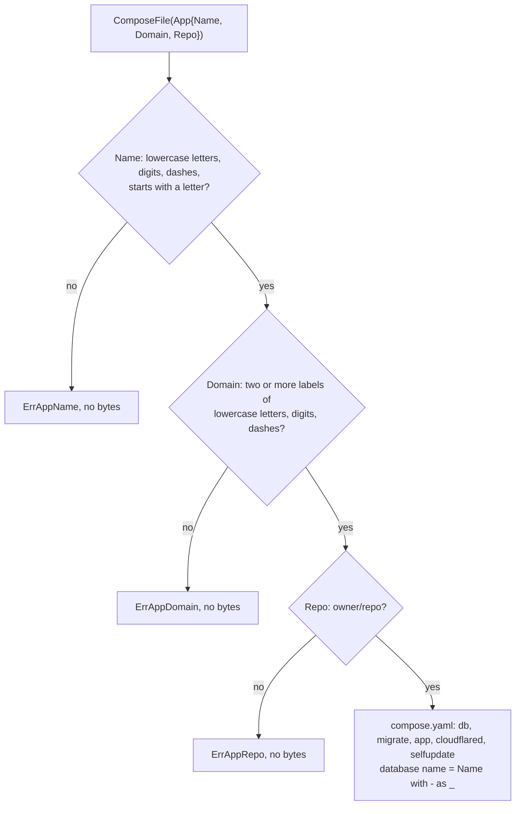
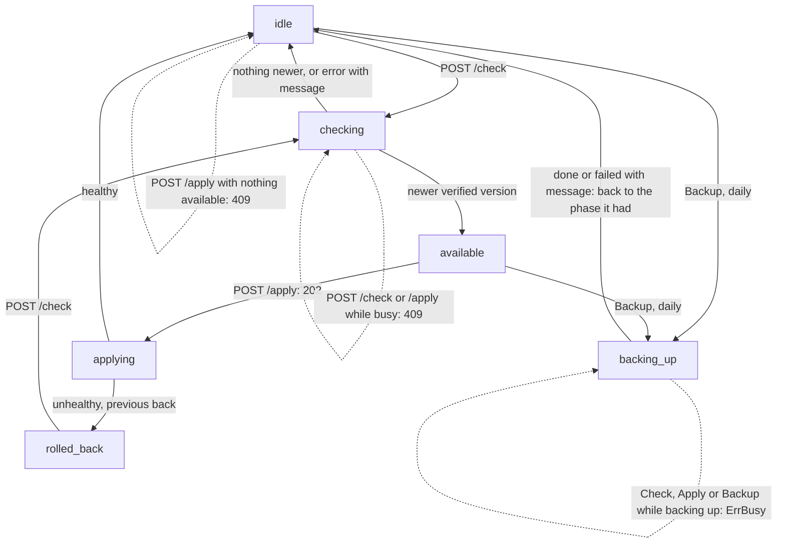

> Read AGENTS.md at the repo root before any change.
> **Finish by yourself:** when the delivery check passes, commit, push and open the pull request. Never ask whether to proceed or finalize — nobody answers, and a session that waits ends without your work.

# S4e + S4f — the compose generator, the `Server` target and the daily backup

**Why.** Today the contract of the server's `compose.yaml` is only a YAML block in `docs/ARCHITECTURE.md`, and the
doc says `webtyp/deploy` writes it. It was decided that **this repo writes it**, next to the contract it already owns
(`layout.go`): `gorelease` calls `selfupdate.ComposeFile(app)` and uploads the result with each Release, and an app
declares `Target: selfupdate.Server` in its `config/deploy.go`. Separately, the supervisor must take **one database copy
a day** (same folder and same limit of 7 as the copy before each switch); the 24-hour timer comes with the `serve`
command in a later plan, this plan adds only `Supervisor.Backup()`.

Delivery rules: commit after every stage. Never run `git reset`, `git restore`, `git checkout -- <file>` or `git stash`
on your own work. Stuck for 30 minutes: open the PR anyway, listing what fails. A PR that does not compile, or whose
tests could not run, is a failed delivery.

## Tools

```bash
go install webtyp.com/devflow/cmd/gotest@latest
go get webtyp.com/deploy@v0.2.114
```

Environment: `GOPRIVATE=webtyp.com/*`, `GOFLAGS=-mod=mod`; run `go mod tidy` after `go get`.

## Ecosystem search

- `grep -rli 'compose' webtyp/*`: `deploy` knows only Workers (`goflare.Worker`); `gorelease` builds images and will
  call this function; nothing else writes a compose file. **New** here, by decision D29 of the master.
- `deploy.TargetID` (`webtyp.com/deploy`, `plan.go`) is the identity type every target constant uses
  (`goflare.Worker`). **Reuse**: `Server` is one more constant of that type.
- Backup: `Applier.backup` (this repo, `apply.go`) already writes and prunes the dumps. **Reuse** it; no second copy.

## Design gate

1. **Prior art.** Kamal (`config/deploy.yml` generates the container setup, https://kamal-deploy.org/docs/configuration/overview/),
   Coolify (generates a compose per app, https://coolify.io/docs/knowledge-base/docker/compose) and Dokku (the tool owns
   the container definition, https://dokku.com/docs/deployment/application-deployment/): the tool that runs the
   containers writes their definition; the app declares only its name and domain. Same here.
2. **Names.** `ComposeFile(app)` — "the compose file of this app"; `Compose` is already the docker engine type, so the
   function cannot be called `Compose`. `App{Name, Domain, Repo}` — the three words a junior uses. `Server` — "deploy to
   a server" (next to `goflare.Worker`). `Backup()` — "take a backup now".
3. **Ledger.** Concepts +2 (`App`, `ComposeFile`) · files the app touches 0 (it declares `Target`) · ways to write the
   compose: 1 → was 0 (hand-written YAML in docs only) · ways to take a backup: still 1 (`Backup()` calls the same
   `backup`).
4. **Where.** The compose describes the services this supervisor drives, with names from `layout.go`: same repo.
   `deploy` stays target-agnostic.
5. **Deletes.** The YAML block in `docs/ARCHITECTURE.md` (replaced by a link to the golden file), the sentence
   "`webtyp/deploy` generates it" (two places: `docs/ARCHITECTURE.md`, `README.md`).

## APIs used

| Symbol | Signature | Tag | File |
|---|---|---|---|
| `deploy.TargetID` | `type TargetID string` — value is `"<import path>.<constant>"` | `webtyp.com/deploy` v0.2.114 | `plan.go` |
| `Applier.backup` (this repo) | `func (a Applier) backup(version string) error` — writes `backups/<now>_<version>.sql` (`""` → `none`), removes the file on error, prunes to `Keep` (0 = 7) | — | `apply.go` |
| `LoadState` (this repo) | `func LoadState(path string) (State, error)` — missing file = zero `State` | — | `state.go` |

If a signature in the published tag differs from this table, stop and name the symbol in the PR; never adapt it by guessing.

## Diagrams first

Create `docs/diagrams/COMPOSE_FILE.md` with this content (every arrow has a test in Stage 4):

````markdown
# ComposeFile

What `selfupdate.ComposeFile(app)` checks before writing the server's `compose.yaml`. `gorelease` calls it with the
app's `config/deploy.go` values and uploads the result with each Release; the signed manifest carries its digest.


````

In `docs/diagrams/PHASES.md`, add `backing_up` to the flowchart (replace the whole block with this):

````markdown

````

## Stage 1 — `layout.go`: the names the compose needs

Add to the existing `const (...)` block (keep every existing constant):

```go
	// DBImage and TunnelImage are pinned: a new version of either is a change to this file.
	DBImage     = "postgres:17"
	TunnelImage = "cloudflare/cloudflared:2026.9.3"

	// EnvSupervisorImage is the .env key with the supervisor's image, written by install;
	// an app update never changes it.
	EnvSupervisorImage = "SUPERVISOR_IMAGE"
	// EnvLANAddress is the .env key with the host address the office door is published on (127.0.0.1 on a dev PC).
	EnvLANAddress = "LAN_ADDRESS"

	// Environment of the app container (the app reads secrets as <KEY>_FILE with webtyp/env).
	EnvPort            = "PORT"
	EnvInternetPort    = "INTERNET_PORT"
	EnvDatabaseURL     = "DATABASE_URL"
	EnvDNSToken        = "CLOUDFLARE_DNS_API_TOKEN"
	EnvSupervisorURL   = "SUPERVISOR_URL"
	EnvSupervisorToken = "SUPERVISOR_TOKEN"
	EnvTunnelToken     = "TUNNEL_TOKEN"

	SecretDatabaseURL      = "database_url"       // postgres://<db>_app:…@db:5432/<db>
	SecretDatabaseOwnerURL = "database_owner_url" // postgres://<db>_owner:…@db:5432/<db>
	// FileInitDB is in secrets/: the SQL that creates the rows-only user on the database's first start.
	FileInitDB = "initdb.sql"

	// NonRootUID is the user of the app and cloudflared images: the secret files they read belong to it.
	NonRootUID = 65532
	// PostgresUID is the postgres user of DBImage: it reads FileInitDB.
	PostgresUID = 999
```

`DBImage`, `TunnelImage` and `NonRootUID`/`PostgresUID` are read by `install` (next plan) and by `gorelease`
(`NonRootUID` in its Dockerfile); the compose test of Stage 4 checks every name appears in the output.

## Stage 2 — `target.go` (new)

```go
package selfupdate

import "webtyp.com/deploy"

// Server is the deploy target of a self-hosted app: a server you own running
// Docker Compose, kept up to date by this supervisor.
// Example (config/deploy.go): return deploy.Plan{Name: "shop", Domain: "app.example.com", Target: selfupdate.Server}
const Server deploy.TargetID = "webtyp.com/selfupdate.Server"
```

## Stage 3 — `composefile.go` (new)

Write it exactly like this. The template is the contract: copy it byte for byte (two-space indentation, no tabs, a
final newline after `certs: {}`).

```go
package selfupdate

import (
	"bytes"
	"errors"
	"strings"
	"text/template"
)

var (
	// ErrAppName: the name is also the folder /opt/<name> and the Compose project.
	ErrAppName = errors.New("selfupdate: app name must be lowercase letters, digits and dashes, starting with a letter")
	// ErrAppDomain: the domain is the name of the certificate and of the health probe.
	ErrAppDomain = errors.New("selfupdate: app domain must be a host name such as app.example.com")
	// ErrAppRepo: the supervisor reads the Releases of this GitHub repository.
	ErrAppRepo = errors.New("selfupdate: app repo must be <owner>/<repo>")
)

const (
	nameDash     = '-'
	dbSeparator  = "_"
	domainDot    = "."
	repoSlash    = "/"
	repoSymbols  = "-_."
	minLabels    = 2
)

// App is what the compose file of one self-hosted app depends on; every other
// name comes from layout.go.
// Example: selfupdate.App{Name: "shop", Domain: "app.example.com", Repo: "acme/shop"}
type App struct {
	Name   string // deploy.Plan.Name: the folder /opt/<Name> and the Compose project
	Domain string // deploy.Plan.Domain: the name the app is reached by
	Repo   string // "<owner>/<repo>" on GitHub, whose Releases the supervisor reads
}

// ComposeFile returns the compose.yaml of app (docs/diagrams/COMPOSE_FILE.md).
// Example: data, err := selfupdate.ComposeFile(selfupdate.App{Name: "shop", Domain: "app.example.com", Repo: "acme/shop"})
func ComposeFile(app App) ([]byte, error) {
	switch {
	case !validName(app.Name):
		return nil, ErrAppName
	case !validDomain(app.Domain):
		return nil, ErrAppDomain
	case !validRepo(app.Repo):
		return nil, ErrAppRepo
	}
	var out bytes.Buffer
	err := composeTemplate.Execute(&out, composeData{
		App:         app,
		DB:          databaseName(app.Name),
		Dir:         AppDir(app.Name),
		DBImage:     DBImage,
		TunnelImage: TunnelImage,
	})
	if err != nil {
		return nil, err
	}
	return out.Bytes(), nil
}

// databaseName is the Postgres name of an app: dashes are not valid in an unquoted identifier.
func databaseName(app string) string { return strings.ReplaceAll(app, string(nameDash), dbSeparator) }

type composeData struct {
	App
	DB, Dir, DBImage, TunnelImage string
}

func isLowerOrDigit(r rune) bool { return r >= 'a' && r <= 'z' || r >= '0' && r <= '9' }

func validName(s string) bool {
	if s == "" || s[0] < 'a' || s[0] > 'z' {
		return false
	}
	for _, r := range s {
		if !isLowerOrDigit(r) && r != nameDash {
			return false
		}
	}
	return true
}

func validDomain(s string) bool {
	labels := strings.Split(s, domainDot)
	if len(labels) < minLabels {
		return false
	}
	for _, l := range labels {
		if l == "" || l[0] == nameDash || l[len(l)-1] == nameDash {
			return false
		}
		for _, r := range l {
			if !isLowerOrDigit(r) && r != nameDash {
				return false
			}
		}
	}
	return true
}

func validRepo(s string) bool {
	owner, repo, ok := strings.Cut(s, repoSlash)
	return ok && validRepoPart(owner) && validRepoPart(repo)
}

func validRepoPart(s string) bool {
	if s == "" {
		return false
	}
	for _, r := range s {
		if !isLowerOrDigit(r) && !(r >= 'A' && r <= 'Z') && !strings.ContainsRune(repoSymbols, r) {
			return false
		}
	}
	return true
}

var composeTemplate = template.Must(template.New(FileCompose).Parse(composeText))

// composeText is the contract of docs/ARCHITECTURE.md; tests/testdata/compose.golden.yaml is its output for acme-shop.
const composeText = `# Generated by webtyp.com/selfupdate ComposeFile; do not edit.
name: {{.Name}}
services:
  db:
    image: {{.DBImage}}
    restart: unless-stopped
    environment:
      POSTGRES_DB: {{.DB}}
      POSTGRES_USER: {{.DB}}_owner
      POSTGRES_PASSWORD_FILE: /run/secrets/db_owner_password
    secrets: [db_owner_password]
    volumes:
      - db_data:/var/lib/postgresql/data
      - ./secrets/initdb.sql:/docker-entrypoint-initdb.d/10-app-user.sql:ro
    healthcheck:
      test: ["CMD-SHELL", "pg_isready -U {{.DB}}_owner -d {{.DB}}"]
      interval: 5s
      timeout: 5s
      retries: 12
  migrate:
    image: ${APP_IMAGE}
    profiles: [migrate]
    entrypoint: ["/app/migrate"]
    environment:
      DATABASE_URL_FILE: /run/secrets/database_owner_url
    secrets: [database_owner_url]
    depends_on:
      db: { condition: service_healthy }
  app:
    image: ${APP_IMAGE}
    restart: unless-stopped
    environment:
      PORT: "8443"
      INTERNET_PORT: "8444"
      APP_DOMAIN: {{.Domain}}
      DATABASE_URL_FILE: /run/secrets/database_url
      CLOUDFLARE_DNS_API_TOKEN_FILE: /run/secrets/dns_token
      SUPERVISOR_URL: http://selfupdate:8080
      SUPERVISOR_TOKEN_FILE: /run/secrets/supervisor_token
    secrets: [database_url, dns_token, supervisor_token]
    ports: ["${LAN_ADDRESS}:443:8443"]
    volumes: [certs:/app/certs]
    depends_on:
      db: { condition: service_healthy }
  cloudflared:
    image: {{.TunnelImage}}
    restart: unless-stopped
    command: ["tunnel", "--no-autoupdate", "run"]
    environment:
      TUNNEL_TOKEN_FILE: /run/secrets/tunnel_token
    secrets: [tunnel_token]
    depends_on: [app]
  selfupdate:
    image: ${SUPERVISOR_IMAGE}
    restart: unless-stopped
    command: ["serve", "{{.Repo}}", "{{.Name}}"]
    volumes:
      - /var/run/docker.sock:/var/run/docker.sock
      - {{.Dir}}:{{.Dir}}
secrets:
  db_owner_password: { file: ./secrets/db_owner_password }
  database_url: { file: ./secrets/database_url }
  database_owner_url: { file: ./secrets/database_owner_url }
  dns_token: { file: ./secrets/dns_token }
  tunnel_token: { file: ./secrets/tunnel_token }
  supervisor_token: { file: ./secrets/supervisor_token }
volumes:
  db_data: {}
  certs: {}
`
```

Anti-footgun: the template is a document, not logic — do **not** replace its literal names with `{{}}` fields for each
layout constant. The test `TestComposeFile_UsesLayoutNames` (Stage 4) is what keeps them equal to `layout.go`.

## Stage 4 — `tests/composefile_test.go` (new) and `tests/testdata/compose.golden.yaml` (new)

`tests/testdata/compose.golden.yaml` is the template above rendered for `App{Name: "acme-shop", Domain:
"app.example.com", Repo: "acme/shop"}`: `{{.Name}}` → `acme-shop`, `{{.DB}}` → `acme_shop`, `{{.DBImage}}` →
`postgres:17`, `{{.TunnelImage}}` → `cloudflare/cloudflared:2026.9.3`, `{{.Domain}}` → `app.example.com`, `{{.Repo}}`
→ `acme/shop`, `{{.Dir}}` → `/opt/acme-shop`. Write it by hand from the template (never generate it with the code under
test). Its `selfupdate` volumes line is `      - /opt/acme-shop:/opt/acme-shop`.

| Test | Setup → call | Expected |
|---|---|---|
| `TestComposeFile_Golden` | `ComposeFile(App{"acme-shop", "app.example.com", "acme/shop"})` | `err == nil`; bytes equal `os.ReadFile("testdata/compose.golden.yaml")` |
| `TestComposeFile_UsesLayoutNames` | same call, `out := string(data)` | `strings.Contains(out, x)` for every `x` in: `"  "+ServiceDB+":"`, `"  "+ServiceMigrate+":"`, `"  "+ServiceApp+":"`, `"  "+ServiceTunnel+":"`, `"  "+ServiceSupervisor+":"`, `"${"+EnvAppImage+"}"`, `"${"+EnvSupervisorImage+"}"`, `"${"+EnvLANAddress+"}:443:"+AppPort`, `EnvPort+": \""+AppPort+"\""`, `EnvInternetPort+": \""+AppInternetPort+"\""`, `EnvAppDomain+":"`, `EnvDatabaseURL+"_FILE"`, `EnvDNSToken+"_FILE"`, `EnvTunnelToken+"_FILE"`, `EnvSupervisorToken+"_FILE"`, `EnvSupervisorURL+": http://"+ServiceSupervisor+":"+SupervisorPort`, `DirSecrets+"/"+FileInitDB`, `DBImage`, `TunnelImage`, `AppDir("acme-shop")`, and `"  "+s+": { file: ./"+DirSecrets+"/"+s+" }"` for `s` in `SecretDBOwner, SecretDatabaseURL, SecretDatabaseOwnerURL, SecretDNSToken, SecretTunnelToken, SecretSupervisorToken` |
| `TestComposeFile_DatabaseName` | `App{"acme-shop", …}` | output contains `"POSTGRES_DB: acme_shop\n"` and `"POSTGRES_USER: acme_shop_owner\n"`; never `"acme-shop_owner"` |
| `TestComposeFile_RejectsName` | Name each of `""`, `"Acme"`, `"1shop"`, `"shop_x"`, `"shop app"`, `"-shop"`; Domain and Repo valid | `data == nil`, `errors.Is(err, ErrAppName)` |
| `TestComposeFile_RejectsDomain` | Domain each of `""`, `"localhost"`, `"app..example.com"`, `"-app.example.com"`, `"app-.example.com"`, `"App.example.com"`, `"app.example.com/"`; Name and Repo valid | `data == nil`, `errors.Is(err, ErrAppDomain)` |
| `TestComposeFile_RejectsRepo` | Repo each of `""`, `"acme"`, `"acme/"`, `"/shop"`, `"acme/shop/x"`, `"acme shop/x"`; Name and Domain valid | `data == nil`, `errors.Is(err, ErrAppRepo)` |
| `TestComposeFile_NameCheckedFirst` | `App{}` | `errors.Is(err, ErrAppName)` |
| `TestComposeFile_AcceptsRepoSymbols` | Repo `"Acme-Labs/shop_v2.web"` | `err == nil`; output contains `"command: [\"serve\", \"Acme-Labs/shop_v2.web\", \"acme-shop\"]"` |
| `TestServer_ID` | — | `string(selfupdate.Server) == "webtyp.com/selfupdate.Server"` |

Run the rejecting tests as table tests with `t.Run(value, …)`.

## Stage 5 — `supervisor.go`: `Backup()` and the `backing_up` phase

1. Add to the `Phase` constants: `PhaseBackingUp Phase = "backing_up"` with the comment
   `// PhaseBackingUp: the daily database copy is running; checks and applies wait.`
2. Add this method, after `begin`:

```go
// busy reports whether a check, an apply or a backup is running; call it with s.mu held.
func (s *Supervisor) busy() bool {
	return s.phase == PhaseChecking || s.phase == PhaseApplying || s.phase == PhaseBackingUp
}
```

3. In `Apply` replace `if s.phase == PhaseChecking || s.phase == PhaseApplying {` with `if s.busy() {`; in `begin`
   the same replacement. After the change `grep -n 'PhaseChecking || s.phase == PhaseApplying' supervisor.go` → empty.
4. Add, after `Apply`:

```go
// Backup takes the daily copy of the database into backups/ (the same files and
// limit as the copy before every switch) and returns to the phase it had.
// Example: for range time.Tick(24 * time.Hour) { s.Backup() }
func (s *Supervisor) Backup() error {
	s.mu.Lock()
	if s.busy() {
		s.mu.Unlock()
		return ErrBusy
	}
	before := s.phase
	s.phase = PhaseBackingUp
	s.mu.Unlock()

	state, err := LoadState(s.statePath)
	if err == nil {
		err = s.applier.backup(state.Version)
	}
	s.mu.Lock()
	defer s.mu.Unlock()
	s.phase = before
	if err != nil {
		s.message = err.Error()
	}
	return err
}
```

The HTTP handler does not change: `POST /apply` already requires `PhaseAvailable` (so it answers 409 while backing
up) and `POST /check` already maps `ErrBusy` to 409.

## Stage 6 — `tests/backup_test.go` (new)

Helper (in this file):

```go
// backupSupervisor is a supervisor whose state says v1.1.0 is running, with its folder.
func backupSupervisor(t *testing.T, eng selfupdate.Engine) (*selfupdate.Supervisor, string) {
	dir := t.TempDir()
	statePath := filepath.Join(dir, selfupdate.FileState)
	selfupdate.State{Version: "v1.1.0", Image: testImage + "@" + testDigest}.Save(statePath)
	clk := &clock{}
	a := selfupdate.Applier{Engine: eng, Dir: dir, Now: clk.Now, Sleep: clk.Sleep}
	return selfupdate.NewSupervisor(selfupdate.Checker{}, a, statePath), dir
}

// blockingEngine holds Backup until release is closed.
type blockingEngine struct {
	fakeEngine
	started, release chan struct{}
}

func (e *blockingEngine) Backup(w io.Writer) error {
	close(e.started)
	<-e.release
	return e.fakeEngine.Backup(w)
}
```

`fakeEngine`, `clock`, `testImage`, `testDigest` already exist in `tests/apply_test.go` and `tests/check_test.go`. The
clock starts at 2023-01-01 12:00:00 UTC, so the dump is `backups/20230101-120000_v1.1.0.sql`.

| Test | Setup → call | Expected |
|---|---|---|
| `TestSupervisor_BackupWritesDump` | `backupSupervisor(t, &fakeEngine{})`; `Backup()` | `nil`; `backups/20230101-120000_v1.1.0.sql` exists with content `dump`; `Status().Phase == "idle"` |
| `TestSupervisor_BackupKeepsAvailable` | `defaultSupervisor(t, &fakeEngine{})`; `Check()`; `Backup()` | `nil`; `Status().Phase == "available"`; `Status().Available == "v1.2.0"` |
| `TestSupervisor_BackupFails` | engine `&fakeEngine{backupErr: errors.New("pg_dump failed")}`; `Backup()` | error whose text contains `pg_dump failed`; `Status().Message == err.Error()`; `Status().Phase == "idle"`; `backups/` has no `.sql` file |
| `TestSupervisor_BackupNoState` | supervisor with `statePath` in an empty temp dir (no state file); `Backup()` | `nil`; `backups/20230101-120000_none.sql` exists |
| `TestSupervisor_BackupPrunes` | `backupSupervisor`; create 7 files `backups/20000101-00000N_v1.0.0.sql` (N = 0…6, mode 0600); `Backup()` | `nil`; exactly 7 `.sql` files remain; `20000101-000000_v1.0.0.sql` is gone; `20230101-120000_v1.1.0.sql` exists |
| `TestSupervisor_BackupWhileBusy` | `eng := &blockingEngine{started: make(chan struct{}), release: make(chan struct{})}`; `done := make(chan error)`; `go func() { done <- s.Backup() }()`; `<-eng.started` | `Status().Phase == "backing_up"`; `s.Check()` → `errors.Is(err, ErrBusy)`; `s.Backup()` → `ErrBusy`; `s.Apply()` → `ErrBusy`; then `close(eng.release)`; `<-done` is `nil`; `Status().Phase == "idle"` |

Run `gotest` (it includes `-race`; the busy test must pass under it).

## Stage 7 — docs

1. `docs/ARCHITECTURE.md`:
   - Section «The compose file — contract»: replace its first paragraph's "`webtyp/deploy` generates it from the app's
     `config/deploy.go`" with "`selfupdate.ComposeFile(selfupdate.App{Name, Domain, Repo})` writes it
     ([diagram](diagrams/COMPOSE_FILE.md)); `gorelease` calls it with `Name` and `Domain` from the app's
     `config/deploy.go`". Replace "`<app>` is `deploy.Plan.Name`, `<domain>` is `deploy.Plan.Domain`" with "`<app>` is
     `App.Name` (`<db>` is the same name with `-` as `_`, because Postgres names have no dashes), `<domain>` is
     `App.Domain`".
   - Replace the whole ```` ```yaml ```` block with: "The exact file, for an app called `acme-shop`:
     [tests/testdata/compose.golden.yaml](../tests/testdata/compose.golden.yaml)." and keep the sentence about the
     internet door after it.
   - After that, add a subsection `### Who reads each secret file` with this table and the sentence after it:

     | File in `secrets/` | Read by | Owner, mode |
     |---|---|---|
     | `db_owner_password` | `db` entrypoint (as root) | root, 0400 |
     | `initdb.sql` | `db` init scripts (as `postgres`, uid 999 = `PostgresUID`) | 999, 0400 |
     | `database_url`, `database_owner_url`, `dns_token`, `supervisor_token` | `app` and `migrate` (uid 65532 = `NonRootUID`) | 65532, 0400 |
     | `tunnel_token` | `cloudflared` (uid 65532) | 65532, 0400 |
     | `github_token` | the supervisor (root), never mounted in another container | root, 0400 |

     "Docker Compose (outside Swarm) mounts a secret file with its owner and mode on the host, so `install` sets them;
     a file the container's user cannot read stops that container at start."
   - Table «The server, on disk», row `.env`: "`APP_IMAGE=<image>@sha256:<digest>`, `SUPERVISOR_IMAGE`, `LAN_ADDRESS` —
     no secrets"; and in the `compose.yaml` row, "generated by `gorelease`" → "written by `ComposeFile`, uploaded by
     `gorelease`".
   - Section «The four services» → title «The services»; text: "`db` (PostgreSQL, data in a named volume, no host port,
     a health check that `migrate` and `app` wait for) · `migrate` (run only by the supervisor) · `app` · `cloudflared`
     (the tunnel, pinned in `TunnelImage`) · `selfupdate` (this supervisor, `SUPERVISOR_IMAGE` from `.env`: the image
     install ran; an app update never changes it; mounts `/var/run/docker.sock` and `/opt/<app>` at the same path, so
     the relative paths of the compose resolve the same inside and outside)."
   - After «Switching», add `## Daily backup`: "`Supervisor.Backup()` writes the same dump as the copy before a switch,
     into `backups/` with the running version in its name, and keeps the newest 7 of both kinds together. While it runs
     the phase is `backing_up` and a check or an apply answers busy. The `serve` command calls it once a day."
   - Add a line «The deploy target: an app's `config/deploy.go` declares `Target: selfupdate.Server`.» at the end of
     «What this is».
2. `README.md`: replace the comment line `// The compose must declare … (generated by \`webtyp/deploy\`).` with
   `// The compose comes from selfupdate.ComposeFile(selfupdate.App{Name: "shop", Domain: "app.example.com", Repo: "acme/shop"}).`;
   add `s.Backup() // once a day` after the `NewSupervisor` line; add `[Compose file](docs/diagrams/COMPOSE_FILE.md)`
   and `[Phases](docs/diagrams/PHASES.md)` to the «See» line.
3. Check: `grep -rn 'webtyp/deploy\` generates\|generated by \`webtyp/deploy\`\|deploy.Plan.Name' README.md docs/` → empty.

## Delivery check

1. `gotest` passes (builds, vets, race, every test above).
2. `git diff --stat main` lists: `layout.go`, `target.go`, `composefile.go`, `supervisor.go`, `go.mod`, `go.sum`,
   `tests/composefile_test.go`, `tests/testdata/compose.golden.yaml`, `tests/backup_test.go`,
   `docs/diagrams/COMPOSE_FILE.md`, `docs/diagrams/PHASES.md`, `docs/ARCHITECTURE.md`, `README.md`.
3. `git diff --stat main --diff-filter=D` → empty.
4. `grep -n 'yaml' docs/ARCHITECTURE.md` shows no ```` ```yaml ```` fence.

## Stages

| # | What | Files |
|---|---|---|
| 1 | Layout names | `layout.go` |
| 2 | `Server` target | `target.go`, `go.mod`, `go.sum` |
| 3 | `ComposeFile` | `composefile.go` |
| 4 | Compose tests + golden | `tests/composefile_test.go`, `tests/testdata/compose.golden.yaml` |
| 5 | `Backup()`, `backing_up` | `supervisor.go` |
| 6 | Backup tests | `tests/backup_test.go` |
| 7 | Docs and diagrams | `docs/ARCHITECTURE.md`, `docs/diagrams/COMPOSE_FILE.md`, `docs/diagrams/PHASES.md`, `README.md` |
