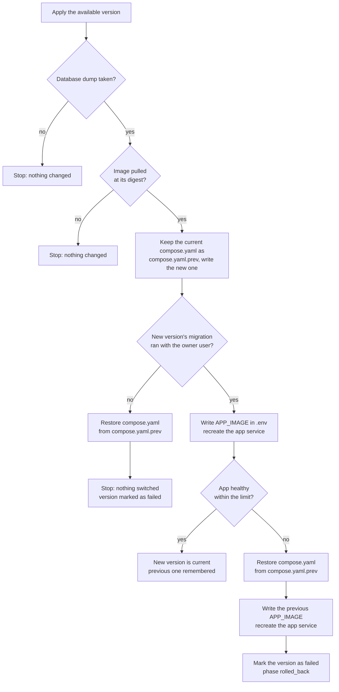

# Apply Flow

When the supervisor receives `POST /apply` (or `Applier.Apply(state, update)` is called directly), it backs up PostgreSQL, pulls the new image by digest, runs database migrations, switches the `app` container, and probes `HTTPS /health`. If migration or health checks fail, it automatically restores the previous configuration. Every branch is verified in `tests/apply_test.go`.

## Step-by-Step Walkthrough

1. **Take pre-update database dump:** Executes `Engine.Backup` (`pg_dump` inside the `db` container) to `/opt/<app>/backups/<timestamp>_<version>.sql` and prunes older dumps beyond the newest 7. If the backup fails, `Apply` aborts immediately before changing anything.
2. **Pull image by `@sha256` digest:** Calls `Engine.Pull(ref)`. If the container registry is unreachable or the digest does not exist, `Apply` aborts while the current version keeps running untouched.
3. **Stage the verified `compose.yaml`:** Copies the current `/opt/<app>/compose.yaml` to `compose.yaml.prev` and atomically writes the new release's `compose.yaml`.
4. **Run schema migrations (`Engine.Migrate`):** Runs the one-off `migrate` service from the new image using `secrets/database_owner_url` (`<db>_owner`).
   - *If migration fails:* Restores `compose.yaml` from `compose.yaml.prev`, appends the new version tag to `state.Failed`, saves `state.json`, and returns `ErrMigrate`. The running `app` container was never stopped.
5. **Switch the `app` container (`Engine.Switch`):** Updates `APP_IMAGE` in `/opt/<app>/.env` and runs `docker compose up -d --no-deps app`.
6. **Poll `HTTPS /health` (`waitHealthy`):** Probes `https://app:8443/health` (verifying the TLS certificate against `APP_DOMAIN`) every 3 seconds (`Every`) for up to 120 seconds (`Wait`).
   - *If healthy:* Writes the new `Version` and `Image` to `state.json` (saving the prior ones in `PreviousVersion` and `PreviousImage`) and completes in phase `idle`.
   - *If unhealthy:* Restores `compose.yaml` from `compose.yaml.prev`, calls `Engine.Switch(state.Image)` to put the previous container back, appends the broken version to `state.Failed`, saves `state.json`, and returns `ErrUnhealthy` (moving the supervisor to phase `rolled_back`).
