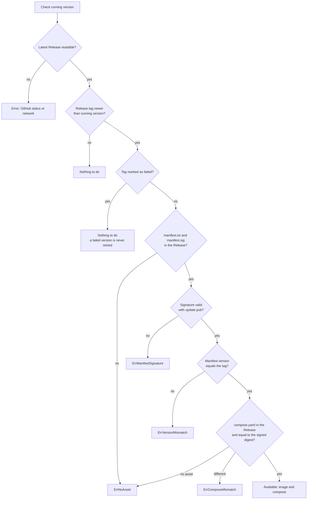

# Check Flow

When `Checker.Check(state)` runs (either during `selfupdate install` or when the app calls `POST /check`), it queries the latest GitHub Release and verifies five cryptographic and version invariants before accepting the release. Every branch is verified in `tests/check_test.go`.

## Step-by-Step Walkthrough

1. **Fetch the latest GitHub Release:** Calls `Releases.Latest()`. If GitHub returns a non-200 HTTP status (such as `401`, `403`, or `404`) or the network is unreachable, returns `ErrGitHubStatus` or the transport error.
2. **Compare semantic versions:** If `state.Version` is non-empty and not older than `Release.Tag` (`!update.IsOutdated`), returns `ok = false, err = nil` (nothing to update). On first install (`state.Version == ""`), any release is treated as newer.
3. **Skip known-bad versions:** Checks `state.HasFailed(Release.Tag)`. If this tag previously failed a migration or health check on this server, returns `ok = false, err = nil` so the broken release is never retried.
4. **Download `manifest.txt` and `manifest.sig`:** Looks up both assets in the Release (`ErrNoAsset` if either is missing).
5. **Verify the P-256 signature first:** Calls `update.VerifyManifest(text, sig, PublicKey)` before parsing or trusting any value in `manifest.txt`. An invalid or forged signature returns `update.ErrManifestSignature`.
6. **Check tag-to-manifest binding:** Verifies that `Manifest.Version == Release.Tag`. If someone copied a valid manifest from `v1.0.0` onto a `v1.1.0` release tag, returns `ErrVersionMismatch`.
7. **Verify `compose.yaml` digest:** Downloads `compose.yaml` (`ErrNoAsset` if missing) and checks its SHA-256 digest against the signed manifest via `Manifest.CheckCompose(compose)` (`update.ErrComposeMismatch` if altered). Only when all checks pass does `Check` return `Update{Manifest, Compose}, true, nil`.
