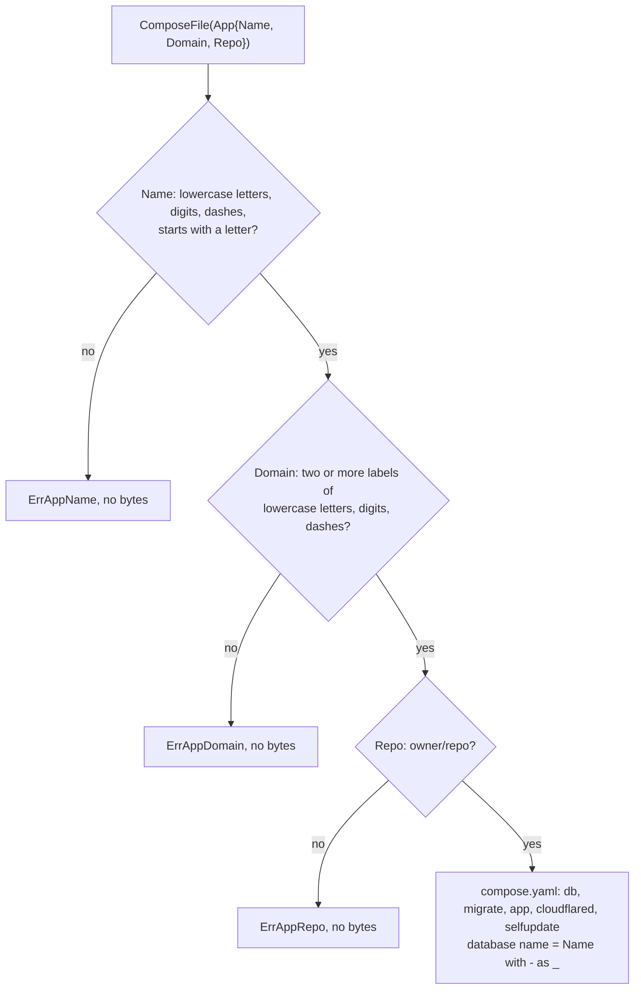

# ComposeFile

What `selfupdate.ComposeFile(app)` checks before writing the server's `compose.yaml`. `gorelease` calls it with the
app's `config/deploy.go` values and uploads the result with each Release; the signed manifest carries its digest.

