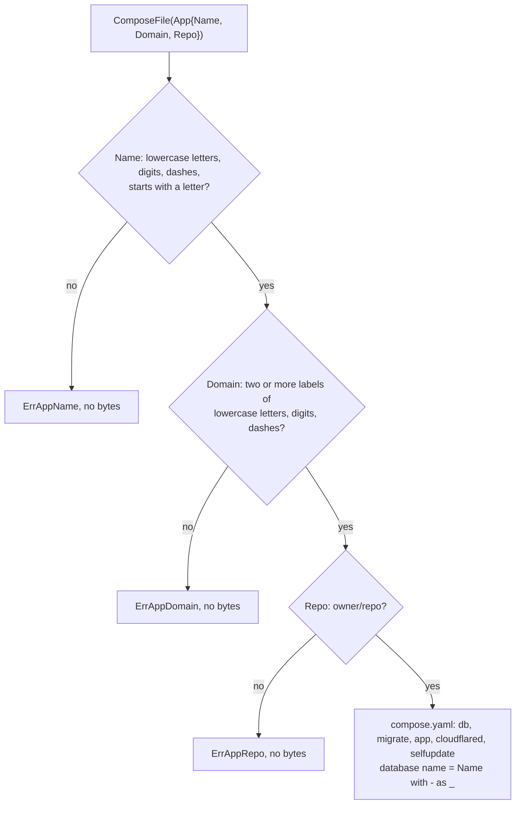

# ComposeFile Flow

When [`webtyp/gorelease`](https://github.com/webtyp/gorelease) packages a self-hosted application, it calls `selfupdate.ComposeFile(app)` with the `Name`, `Domain`, and `Repo` declared in the project's `config/deploy.go`. This flow validates all three inputs before generating the server's `compose.yaml` file. Every branch is verified in `tests/composefile_test.go`.

## Step-by-Step Walkthrough

1. **Validate `App.Name`:** Checks that `Name` is non-empty, starts with a lowercase letter (`a–z`), and contains only lowercase letters, digits (`0–9`), and dashes (`-`). Because `Name` becomes the directory `/opt/<Name>` and the Docker Compose project name, invalid characters immediately return `ErrAppName`.
2. **Validate `App.Domain`:** Splits `Domain` on dots (`.`) and checks that there are at least two labels (such as `app.example.com`), with each label containing only lowercase letters, digits, and interior dashes. Invalid domains return `ErrAppDomain`.
3. **Validate `App.Repo`:** Checks that `Repo` has the form `<owner>/<repo>` with non-empty alphanumeric/dash/underscore/dot segments. Invalid repositories return `ErrAppRepo`.
4. **Render `compose.yaml`:** Converts any dashes in `App.Name` to underscores (`_`) to form a valid PostgreSQL identifier (`<db>`), and renders the 5-service Docker Compose specification (`db`, `migrate`, `app`, `cloudflared`, `selfupdate`).
