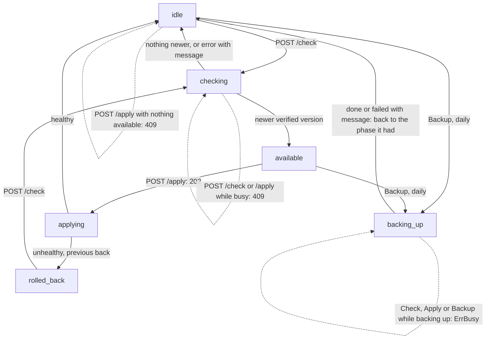

# Supervisor Phases

The `Supervisor` coordinates update checks, container switches, and daily database backups so only one operation runs at a time. The running application inspects this state via `GET /status` and triggers transitions via `POST /check` and `POST /apply`. Every transition and conflict branch is verified in `tests/supervisor_test.go`.

## Step-by-Step Walkthrough

1. **`idle` (Starting state):** No operation is running and no update is waiting. Calling `POST /apply` while `idle` returns `409 Conflict` (`ErrNothingToApply`).
2. **`checking` (`POST /check`):** The supervisor queries GitHub and verifies the release signature. Any concurrent `POST /check`, `POST /apply`, or `Backup` while in `checking` returns `409 Conflict` (`ErrBusy`).
   - If a newer verified release is found, the supervisor caches the `Update` in memory and enters `available` (`200 OK`).
   - If the running version is already current, it returns to `idle` (`200 OK`).
   - If GitHub or signature verification fails, it records the error in `Status.Message`, returns to `idle`, and answers `502 Bad Gateway`.
3. **`available`:** A verified release is waiting in memory. When the application sees no active user sessions (or reaches its maintenance window), it sends `POST /apply`.
4. **`applying` (`POST /apply`):** `POST /apply` immediately transitions to `applying`, starts `Applier.Apply` in a background goroutine, and returns `202 Accepted`.
   - If the new container passes its health check, `state.json` is updated and the phase returns to `idle`.
   - If the new container fails its health check (`ErrUnhealthy`), `Applier` restores the previous version and the phase moves to `rolled_back` with the error recorded in `Status.Message`.
5. **`rolled_back`:** Indicates the last update attempt was automatically reverted. Once a fixed release is published, the next `POST /check` moves from `rolled_back` to `checking`.
6. **`backing_up` (Daily `Backup`):** Triggered every 24 hours from `idle` or `available`. While the database dump runs, concurrent `Check` or `Apply` requests receive `ErrBusy` (`409 Conflict`). When the dump finishes, the supervisor returns to whichever phase (`idle` or `available`) it held before.
