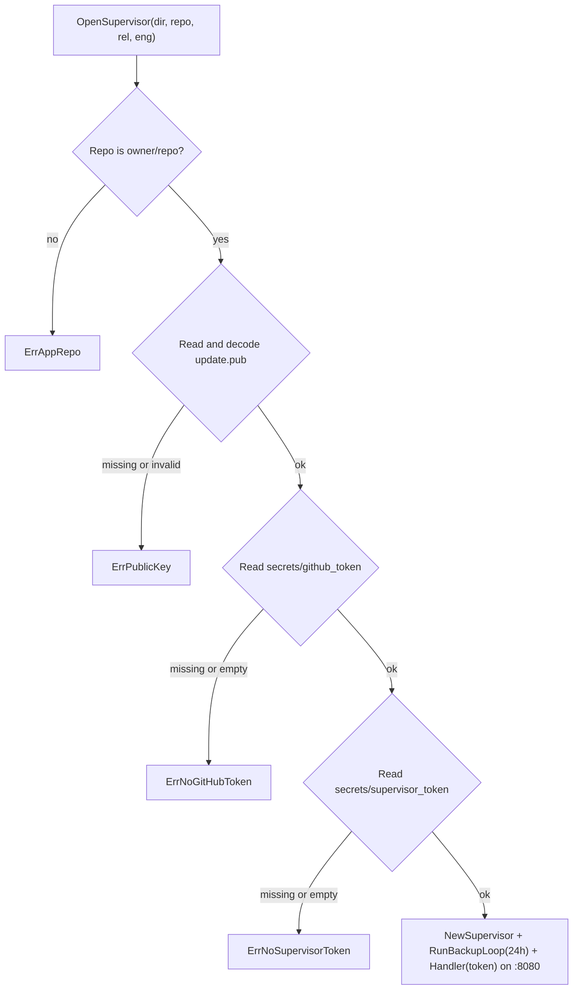

# Serve Flow

When the `selfupdate` supervisor container starts, Docker Compose runs `selfupdate serve <owner/repo> <app>`. This flow loads the public key and secrets from `/opt/<app>`, starts the 24-hour database backup loop, and opens the bearer-authenticated HTTP server on `:8080`. Every branch is verified in `tests/serve_test.go`.

## Step-by-Step Walkthrough

1. **Validate `repo`:** Confirms the `<owner>/<repo>` argument is well-formed (`ErrAppRepo` otherwise).
2. **Load `update.pub`:** Reads `/opt/<app>/update.pub` and validates that it is a valid P-256 PKIX public key (`ErrPublicKey` if missing or corrupted).
3. **Load `secrets/github_token`:** Reads the read-only GitHub token from `/opt/<app>/secrets/github_token` (`ErrNoGitHubToken` if missing or blank).
4. **Load `secrets/supervisor_token`:** Reads the shared bearer token from `/opt/<app>/secrets/supervisor_token` (`ErrNoSupervisorToken` if missing or blank).
5. **Start backup loop and HTTP server:** Constructs `*Supervisor` wired to `/opt/<app>/state.json`, starts `RunBackupLoop` in a background goroutine (triggering `Supervisor.Backup()` every 24 hours), and listens on `:8080` with `Supervisor.Handler(token)`.
